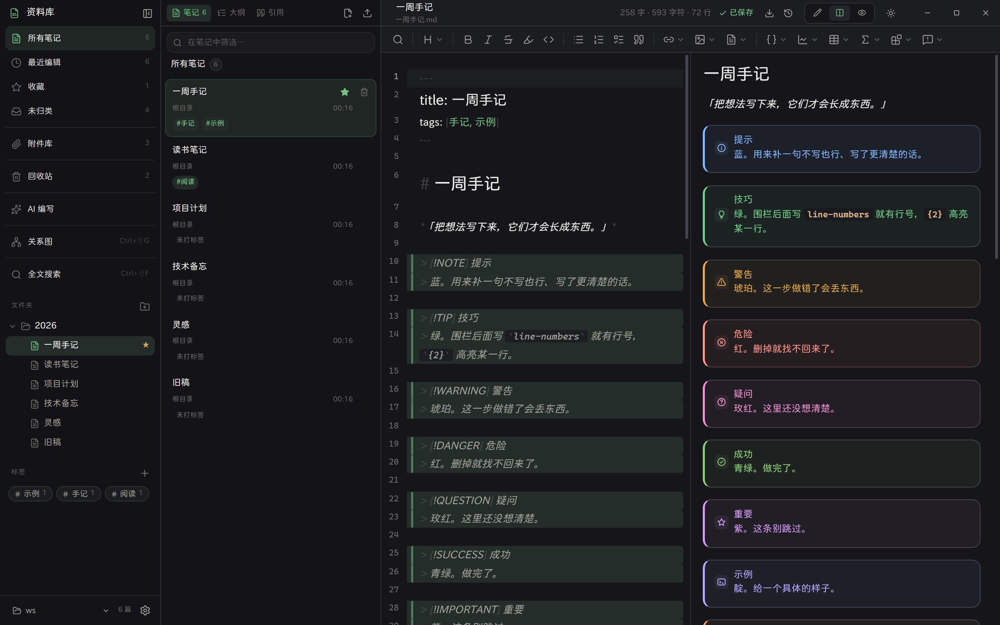
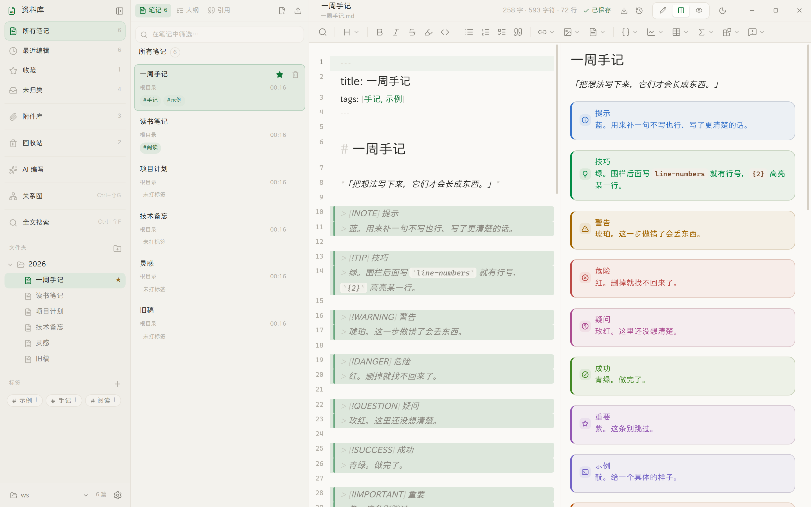
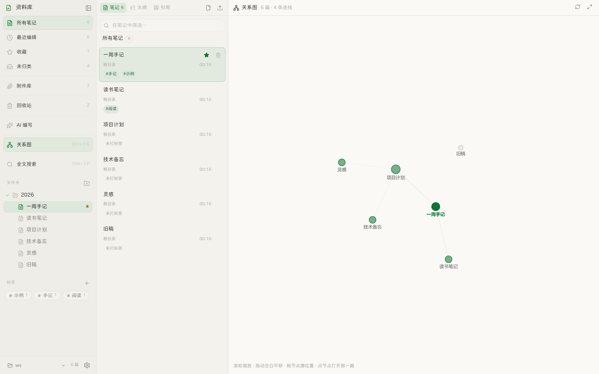
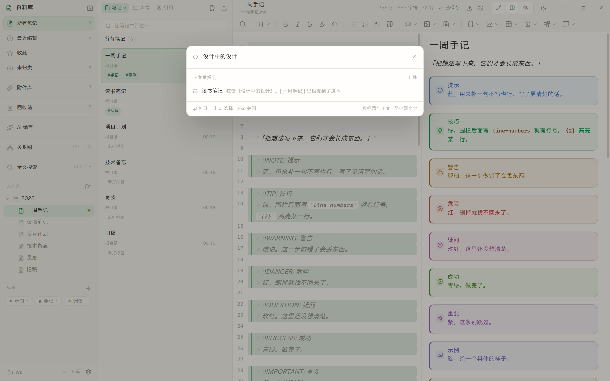
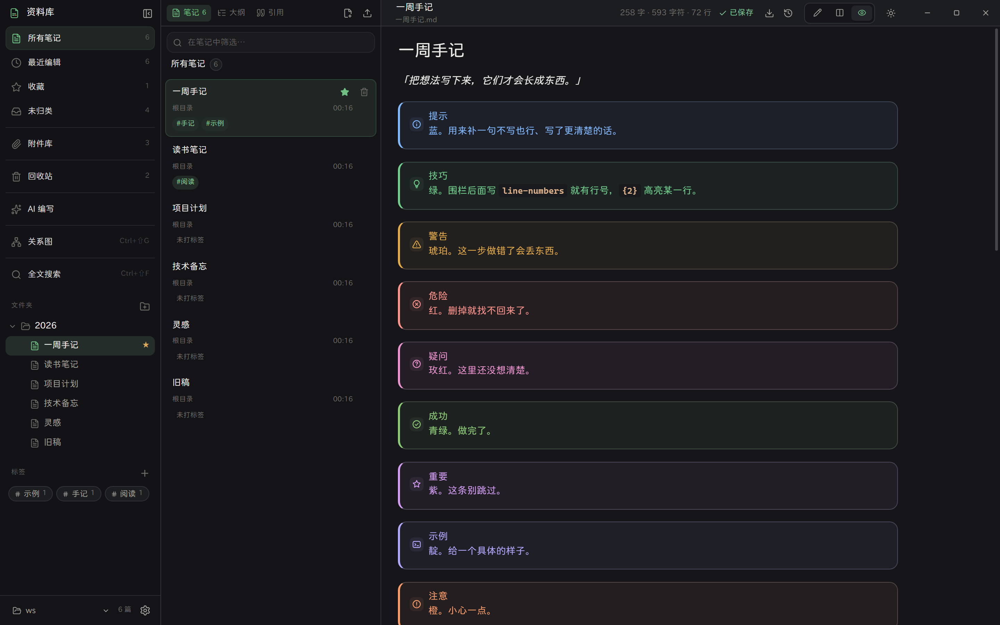

# Nota

一个只做笔记的 Markdown 桌面应用。

纯本地、不联网、不上传。你的笔记就是磁盘上的 `.md` 文件，任何时候都能用别的编辑器打开。

<p align="center">
  
</p>

## 特性

- **纯本地存储** — 笔记直接写进你选择的目录，没有数据库、没有云端
- **Markdown** — 写作与预览双模式，源码即文件
- **双链三件套** — `[[笔记]]` 指过去、`![[笔记]]` 拉进来、`[[笔记#^块]]` 指到某一段；三种都弹选择器选，不用手打
- **关系图** — `Ctrl+Shift+G`，把「谁提到了谁」画成一张可缩放的图
- **搜索面板** — `Ctrl+P` 按标题跳笔记，`Ctrl+Shift+F` 搜正文（带上下文片段）
- **十一种提示块** — 每种一个色相 + 一枚描边记号；Mermaid 图表配色跟深浅主题走
- **CodeMirror 6 编辑器** — 语法高亮、行号、折叠、多光标、搜索替换
- **工具栏** — 7 个下拉菜单，按「搜索 / 标题 / 行内格式 / 列表 / 链接·图片·笔记 / 代码·表格·数学·内容块」分组，共 30 余种插入与格式命令
- **斜杠命令** — 空行输入 `/` 唤出菜单，36 项与工具栏功能对齐，支持中文标签与英文别名过滤（`/标题`、`/h1`、`/kuai`）
- **代码块语言补全** — 输入 ` ``` ` 后自动提示语言，支持 16 种语言高亮
- **字数统计** — 中英混排按字数/字符/行数分别统计
- **轻** — 没有账号、没有插件市场、没有同步服务
- **深浅主题** — 跟随系统或手动切换
- **无边框窗口** — 自绘标题栏，界面完全可控
- **快捷键** — `Ctrl+O` 打开目录、`Ctrl+N` 新建、`Ctrl+S` 保存、`Ctrl+B/I/E` 格式、`Ctrl+1..6` 标题、
  `Ctrl+P` 跳笔记、`Ctrl+Shift+F` 搜正文、`Ctrl+Shift+G` 关系图、`Ctrl+\` 收侧栏
- **记住上次** — 退出时记住工作区和正在看的那篇，下次打开直接回到原处
- **粘贴图片自动压缩** — 超过 1 MB 等比压到长边 1600，几十张截图也不会把目录撑爆

## 截图

分栏视图（左写右看）：



提示块与图表：



关系图：



搜索面板：



深色：



完整宣传页见 [`site/index.html`](./site/index.html)。

## 下载

从 [Releases](../../releases) 页面获取最新版本：

- `Nota-Setup-x.y.z.exe` — 安装版（可自选安装目录）
- `Nota-Portable-x.y.z.exe` — 免安装版，双击即用

## 开发

```bash
npm install
npm run dev
```

`npm run dev` 会启动 Vite 开发服务器，并自动构建主进程、拉起 Electron 窗口。改 `src/` 下的文件会热更新。

## 构建

```bash
npm run build        # 类型检查 + 前端构建 + 主进程构建
npm run pack         # 发布打包：滚版本 → 删旧包 → 构建 → 出安装包
npm run pack:rebuild # 同上传，但沿用当前版本号（只重新打包）
npm run verify       # 无头启动应用并断言关键 UI，截图输出到 docs/
```

### 打包即发布

`npm run pack` 是**唯一的发布入口**，它会按顺序做四件事：

1. **滚版本号** — `0.2.0 → 0.3.0 → 0.4.0`（minor 递增，patch 归零；`0.9.0` 之后进 `1.0.0`）
2. **挪走旧产物** — `release/` 下所有历史的 `.exe` / `.blockmap` / `.yml` 移到 `.trash/`，只保留本次输出
3. **清 `dist/`** — 同样用改名挪到 `.trash/`，再建一个空目录（见下）
4. **构建 + 打包** — 前端、主进程、NSIS 安装版、Portable 免安装版

所以 `release/` 目录里**永远只有最新一版**的两个 `.exe`，不会越堆越多。

想要先看看会做什么而不真跑：`node scripts/release.mjs --dry`

#### 清理为什么用「改名」而不是「删除」

本机安全层对删除有**按 turn 累计**的阈值：同一个 turn 内删超过 50 个文件就报 `SAFE_DELETE_BULK_CONFIRM_REQUIRED`。

这带来一个反直觉的后果：**逐个删是不够的**。`clean.mjs` 就算每次只删 1 个文件，删掉 46 个之后，Vite 在 build 前还会自己 `emptyDir('dist')` 一次——而 `dist/assets` 里有上百个文件，累计瞬间破 50，构建在半路失败。

所以改成两处一起动手：

- `clean.mjs` 与 `release.mjs` 用 `renameSync` 把旧目录整体挪进 `.trash/<名字>-<时间戳>`。**改名不是删除**，完全不触发守卫，整个清理只要 1 次 fs 调用。
- `vite.config.ts` 设 `emptyOutDir: false`，关掉 Vite 自己那次清目录——反正目录进来时已经是空的。

`.trash/` 已在 `.gitignore` 里，积攒的旧目录不影响构建（目标路径每次都是全新的空目录），可在系统空闲时手工清理。

## 项目结构

```
electron/
  main.ts          主进程：窗口、菜单、文件系统 IPC
  preload.ts       安全桥接，暴露白名单 API 给渲染进程
src/
  main.ts          渲染进程入口
  App.vue          三栏布局骨架
  store/           状态层（Vue reactive）
  editor/          编辑器内核
    setup.ts               CodeMirror 基础扩展集合
    theme.ts               编辑器主题 + 语法配色（编辑/预览共用一张表）
    live-preview.ts        Markdown 实时呈现：标题层级、标记淡化、引用竖线
    highlight-code.ts      预览代码块的语法高亮（复用编辑器同一套 token）
    markdown-commands.ts   纯函数：Markdown 文本变换
    toolbar-commands.ts    视图层命令，包一层 dispatch
    toolbar-keymap.ts      工具栏快捷键绑定
    slash-commands.ts      `/` 命令菜单扩展
    code-lang-complete.ts  代码块语言补全
    code-languages.ts      语言注册与代码块行装饰
    markdown-snippets.ts   模板片段常量
    word-count.ts          中英混排字数统计
  components/      界面组件（Toolbar / SlashMenu / EditorPane / SidePanel /
                   SearchPalette 搜索面板 / GraphView 关系图 ...）
  styles/          设计 token 与全局样式
site/              宣传页（index.html + shots/ 真实界面截图）
build/
  icon-source.png  图标母版（1024×1024 RGBA，四角透明）
  icon.ico         打包用图标（多尺寸）
  make-icon.cjs    图标生成脚本
scripts/
  probe.mjs        无头验证脚本（CDP 驱动，断言 + 截图）
  verify-commands.mjs 命令行为验证（真跑「正文」与「隐藏注释」并比对文本）
  verify-toolbar.mjs  工具栏验证：7 个下拉能否展开/高亮/执行，图标是否渲染成描边
  clean.mjs        清理 dist（用改名绕开批量删除限制）
  release.mjs      发布打包：滚版本 → 删旧包 → 构建 → 出安装包
build-electron.mjs 主进程构建脚本（esbuild → CJS）
```

## 技术栈

| 层 | 选型 |
|---|---|
| 桌面壳 | Electron 33 |
| 前端 | Vue 3 + TypeScript |
| 构建 | Vite 6（前端） + esbuild（主进程） |
| 编辑器 | CodeMirror 6 |
| Markdown | @codemirror/lang-markdown（编辑）+ marked（预览） |
| 图标 | Lucide（lucide-vue-next，ISC） |
| 样式 | 原生 CSS + 自定义属性 |

没有引入任何 UI 组件库。所有界面手写，设计 token 以 `--n-` 为前缀。

### 图标为什么用 Lucide，而不是自己画

工具栏图标全部来自 [Lucide](https://lucide.dev)（`lucide-vue-next`）。选它有一个很实际的原因：Lucide 是 Lucide 生态的原始上游，许可为 **ISC**（其中一部分来自 Feather 的图标为 MIT），只要求保留版权声明，商用、修改、再分发都不受限，也不产生任何 copyleft 牵连。

需要区分的是：此前参考过的 `shuaiplus/inkstone` 项目**整体是 LGPL-3.0**，它的源码不能照搬（照搬会让本项目被 LGPL 覆盖）。但它工具栏用的图标本身就来自 Lucide，所以「用它的图标」的正确做法是**直接依赖 Lucide**——拿到的几何完全一致，而许可链条干净。走上游，而不是走中间商。

用法上有一处必须注意：Lucide 图标是**描边**画的（`fill="none"` + `stroke`），和常见的填充路径图标不同。`Toolbar.vue` 里因此显式写了 `fill: none; stroke: currentColor`——如果沿用填充图标的 `fill: currentColor`，这些图标会糊成实心黑块。

### 编辑器设计要点

`editor/` 下的文本变换全部是纯函数：`(doc, selection) => { change, selection }`，不依赖编辑器实例、不读写全局状态。视图层命令（`toolbar-*`）只负责把结果包成一个 CodeMirror transaction 并重新聚焦，因此每次操作恰好产生一次撤销步。

这种分层让核心逻辑可以直接跑单元测试，也让斜杠命令与工具栏按钮复用同一套实现，行为不会漂移。

### 顶部区域为什么是「标题栏 + 工具栏」两层

早期版本把「编辑 / 预览」两个按钮塞在工具栏**下方**，视野重心偏低，看着也不像正经笔记软件。现在是一条 44px 的**标题栏压在工具栏之上**：

- **左**：可编辑标题。平时渲染成纯文本，**悬停 / 聚焦才显形**成输入框——一排常驻边框会把界面切得太碎。回车或失焦真正改名，Esc 撤销。
- **右**：字数统计、未保存小圆点、以及一个**三段式视图切换**（编辑 / 分栏 / 预览）。

分段控件是「凹陷底槽 + 选中项浮起成白块」的结构（`role="radiogroup"` + `role="radio"` + `aria-checked`），比单纯换背景色更能表达「这是一组可切换的档位」。`Ctrl+1/2/3` 也能切。

分栏模式下编辑区与预览区各占一半，中间一条分隔线。**注意分栏时正文的居中留白要按比例收窄**：正文居中用的是 `calc((100% - measure) / 2)`，栏宽减半后这个差值会算成负数，正文直接贴边，所以分栏态单独覆盖了 `padding-inline`。

另一处容易踩的坑：阅读模式会销毁 CodeMirror 省内存，但**分栏模式必须让编辑器活着**，所以模式监听里判断的是 `if (mode === 'read')` 而不是 `!== 'write'`。

类名统一带 `ph-` 前缀（pane header）。`SidePanel.vue` 里已经有一个 `.head`，泛用类名虽然被 scoped CSS 隔离、功能上不冲突，但会打乱 DOM 探针、也让后续维护犯迷糊。

### 编辑区与预览区为什么必须共用配色

编辑区走 CodeMirror 的 `HighlightStyle`（产出内联样式），预览区是 `marked` 生成的静态 HTML（只能挂 class），两边的渲染机制完全不同。

如果各自配一套颜色，很快就会出现「同一个代码块在编辑和预览里长得不一样」。所以 `theme.ts` 里只维护**一张**「标签 → 语义」表，再由它派生出两份产物：

- `notaHighlight` —— `HighlightStyle`，给编辑区用；
- `notaHighlightClass` —— `tagHighlighter`，产出 `.cm-hl-*` 类名，给预览区用。

颜色本身统一写在 `styles/tokens.css` 的 `.cm-hl-*` 规则里，两边都读同一组 `--n-code-*` 变量。预览侧的高亮实现（`highlight-code.ts`）直接借道 CodeMirror 自己的 Lezer 语言去解析，而不是再引入一个高亮库——这样连「哪个 token 算关键字」的判定都同源，不会一边认得 `const`、另一边认不得。

### 正文列为什么这样居中

CodeMirror 的 `.cm-gutters`（行号）和 `.cm-content`（正文）是 `.cm-scroller` 里的**并列 flex 子节点**，不是父子关系。所以：

- 只给 `.cm-content` 设 `max-width + margin: 0 auto`，正文会单独居中，行号却被留在窗口最左侧——两者脱节，视觉上正文像挤在一条窄带里。
- 正确做法是给 `.cm-scroller` 加左右对称的 padding：`padding-inline: max(20px, calc((100% - var(--n-measure)) / 2))`，让「行号 + 正文」整对一起居中。
- 垂直留白（底部那句 `42vh` 的滚动余量）也放在 scroller 上，避免跟着窄列一起错位。

预览模式（`.preview`）用同一个公式，保证「编辑 / 预览」切换时正文列完全对齐。

### 下拉菜单为什么要 Teleport 到 body

工具栏 `.tb` 是横向滚动容器（`overflow-x: auto` + `overflow-y: hidden`，窄窗口下用）。**`overflow` 不为 `visible` 的元素会裁掉所有溢出的子节点——包括绝对定位的下拉菜单。**

这个坑很隐蔽：菜单一直在 DOM 里、`getBoundingClientRect()` 也返回真实尺寸，只是视觉上被裁没了。表现出来就是「点了按钮有高亮，但菜单不出来」，而任何只断言「元素存在」的测试都会误判为通过。

所以菜单统一 Teleport 到 `body`，用 `position: fixed` 按锚点按钮的实时坐标摆放（见 `placeMenu()`）。这样既保住了工具栏的横向滚动，菜单又能正常盖在编辑器之上。相应地：

- 窗口 `resize` 或工具栏滚动时要重新摆位（`fixed` 不随滚动容器一起走）；
- 右对齐不再靠 class，而是算坐标时判断「左边放会超出窗口就翻成右对齐」。

⚠️ 若要给工具栏加新的浮层（tooltip、popover 等），务必同样 Teleport 出去，否则会被 `.tb` 裁掉。

### 为什么主进程用 esbuild 而不是 vite-plugin-electron

该插件在 dev 模式下会覆盖 `rollupOptions.output.format`，强制输出 ESM，导致 `.cjs` 文件里出现 `import` 语句而启动崩溃。改用 esbuild 直接构建，dev 与生产行为完全一致，构建耗时约 30ms。

## 授权

本项目源码：MIT License，详见 [LICENSE](./LICENSE)。

### 第三方声明

- **Lucide 图标**（`lucide-vue-next`）—— ISC License，Copyright (c) Lucide Icons and Contributors。其中部分图标源自 Feather，为 MIT License，Copyright (c) Cole Bemis。完整条款见 `node_modules/lucide-vue-next/LICENSE`。
- **CodeMirror 6**、**Vue 3**、**marked**、**Electron** 等依赖各自遵循其原有许可，详见 `node_modules/` 内各包。
