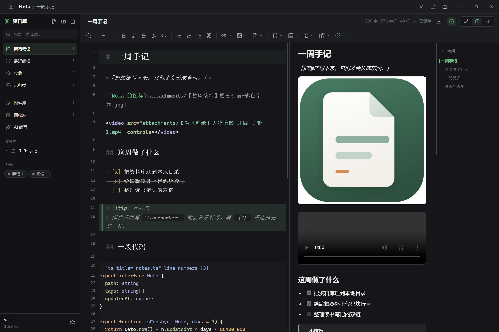
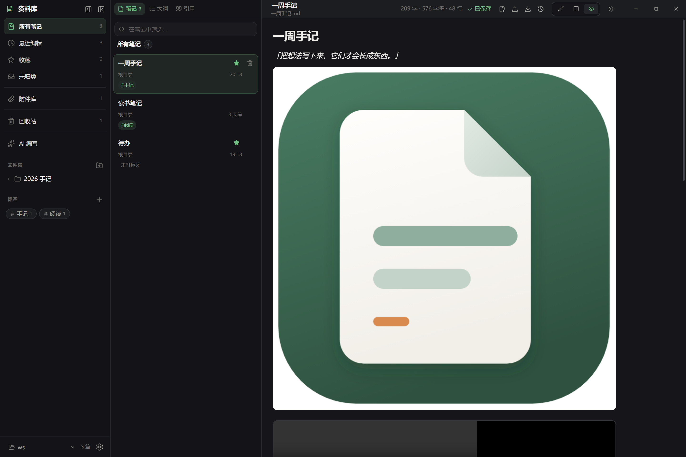

# Nota

一个只做笔记的 Markdown 桌面应用。

纯本地、不联网、不上传。你的笔记就是磁盘上的 `.md` 文件，任何时候都能用别的编辑器打开。

<p align="center">
  
</p>

## 特性

- **纯本地存储** — 笔记直接写进你选择的目录，没有数据库、没有云端
- **Markdown** — 写作与预览双模式，源码即文件
- **CodeMirror 6 编辑器** — 语法高亮、行号、折叠、多光标、搜索替换
- **工具栏** — 7 个下拉菜单，按「搜索 / 标题 / 行内格式 / 列表 / 链接·图片·笔记 / 代码·表格·数学·内容块」分组，共 30 余种插入与格式命令
- **斜杠命令** — 空行输入 `/` 唤出菜单，36 项与工具栏功能对齐，支持中文标签与英文别名过滤（`/标题`、`/h1`、`/kuai`）
- **代码块语言补全** — 输入 ` ``` ` 后自动提示语言，支持 16 种语言高亮
- **字数统计** — 中英混排按字数/字符/行数分别统计
- **轻** — 没有账号、没有插件市场、没有同步服务
- **深浅主题** — 跟随系统或手动切换
- **无边框窗口** — 自绘标题栏，界面完全可控
- **快捷键** — `Ctrl+O` 打开目录、`Ctrl+N` 新建、`Ctrl+S` 保存、`Ctrl+B/I/E` 格式、`Ctrl+1..6` 标题

## 截图

浅色：



深色：



## 下载

从 [Releases](../../releases) 页面获取最新版本：

- `Nota-Setup-x.y.z.exe` — 安装版（可自选安装目录）
- `Nota-Portable-x.y.z.exe` — 免安装版，双击即用

## 开发

```bash
npm install
npm run dev
```

`npm run dev` 会启动 Vite 开发服务器，并自动构建主进程、拉起 Electron 窗口。改 `src/` 下的文件会热更新。

## 构建

```bash
npm run build      # 类型检查 + 前端构建 + 主进程构建
npm run pack       # 打包成 Windows 安装包（输出到 release/）
npm run verify     # 无头启动应用并断言关键 UI，截图输出到 docs/
```

## 项目结构

```
electron/
  main.ts          主进程：窗口、菜单、文件系统 IPC
  preload.ts       安全桥接，暴露白名单 API 给渲染进程
src/
  main.ts          渲染进程入口
  App.vue          三栏布局骨架
  store/           状态层（Vue reactive）
  editor/          编辑器内核
    setup.ts               CodeMirror 基础扩展集合
    theme.ts               编辑器主题（桥接 --n-* token）
    markdown-commands.ts   纯函数：Markdown 文本变换
    toolbar-commands.ts    视图层命令，包一层 dispatch
    toolbar-keymap.ts      工具栏快捷键绑定
    slash-commands.ts      `/` 命令菜单扩展
    code-lang-complete.ts  代码块语言补全
    code-languages.ts      语言注册与代码块行装饰
    markdown-snippets.ts   模板片段常量
    word-count.ts          中英混排字数统计
  components/      界面组件（Toolbar / SlashMenu / EditorPane / SidePanel ...）
  styles/          设计 token 与全局样式
build/
  icon.svg         图标源文件
  icon.ico         打包用图标（多尺寸）
  make-icon.cjs    图标生成脚本
scripts/
  probe.mjs        无头验证脚本（CDP 驱动，断言 + 截图）
  verify-commands.mjs 命令行为验证（真跑「正文」与「隐藏注释」并比对文本）
  clean.mjs        分批清理 dist，绕开大批量删除限制
build-electron.mjs 主进程构建脚本（esbuild → CJS）
```

## 技术栈

| 层 | 选型 |
|---|---|
| 桌面壳 | Electron 33 |
| 前端 | Vue 3 + TypeScript |
| 构建 | Vite 6（前端） + esbuild（主进程） |
| 编辑器 | CodeMirror 6 |
| Markdown | @codemirror/lang-markdown（编辑）+ marked（预览） |
| 样式 | 原生 CSS + 自定义属性 |

没有引入任何 UI 组件库。所有界面手写，设计 token 以 `--n-` 为前缀。

### 编辑器设计要点

`editor/` 下的文本变换全部是纯函数：`(doc, selection) => { change, selection }`，不依赖编辑器实例、不读写全局状态。视图层命令（`toolbar-*`）只负责把结果包成一个 CodeMirror transaction 并重新聚焦，因此每次操作恰好产生一次撤销步。

这种分层让核心逻辑可以直接跑单元测试，也让斜杠命令与工具栏按钮复用同一套实现，行为不会漂移。

### 正文列为什么这样居中

CodeMirror 的 `.cm-gutters`（行号）和 `.cm-content`（正文）是 `.cm-scroller` 里的**并列 flex 子节点**，不是父子关系。所以：

- 只给 `.cm-content` 设 `max-width + margin: 0 auto`，正文会单独居中，行号却被留在窗口最左侧——两者脱节，视觉上正文像挤在一条窄带里。
- 正确做法是给 `.cm-scroller` 加左右对称的 padding：`padding-inline: max(20px, calc((100% - var(--n-measure)) / 2))`，让「行号 + 正文」整对一起居中。
- 垂直留白（底部那句 `42vh` 的滚动余量）也放在 scroller 上，避免跟着窄列一起错位。

预览模式（`.preview`）用同一个公式，保证「编辑 / 预览」切换时正文列完全对齐。

### 为什么主进程用 esbuild 而不是 vite-plugin-electron

该插件在 dev 模式下会覆盖 `rollupOptions.output.format`，强制输出 ESM，导致 `.cjs` 文件里出现 `import` 语句而启动崩溃。改用 esbuild 直接构建，dev 与生产行为完全一致，构建耗时约 30ms。

## 授权

MIT License，详见 [LICENSE](./LICENSE)。
