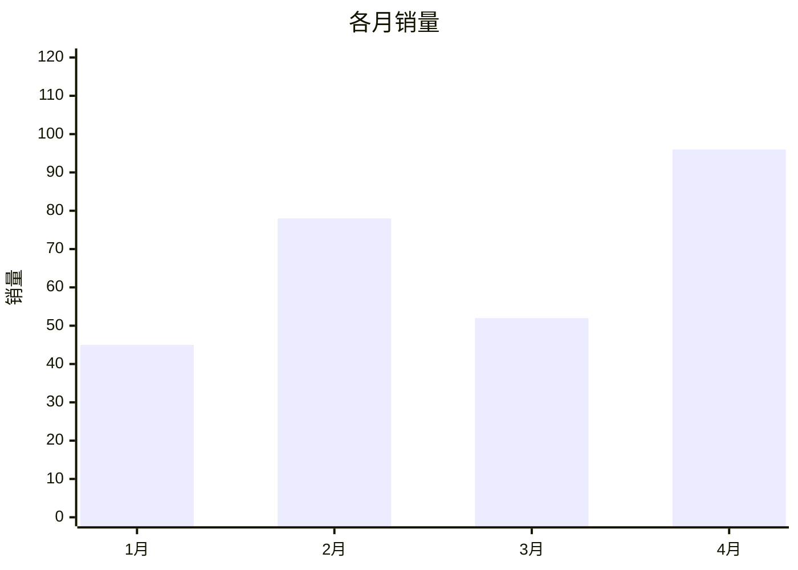
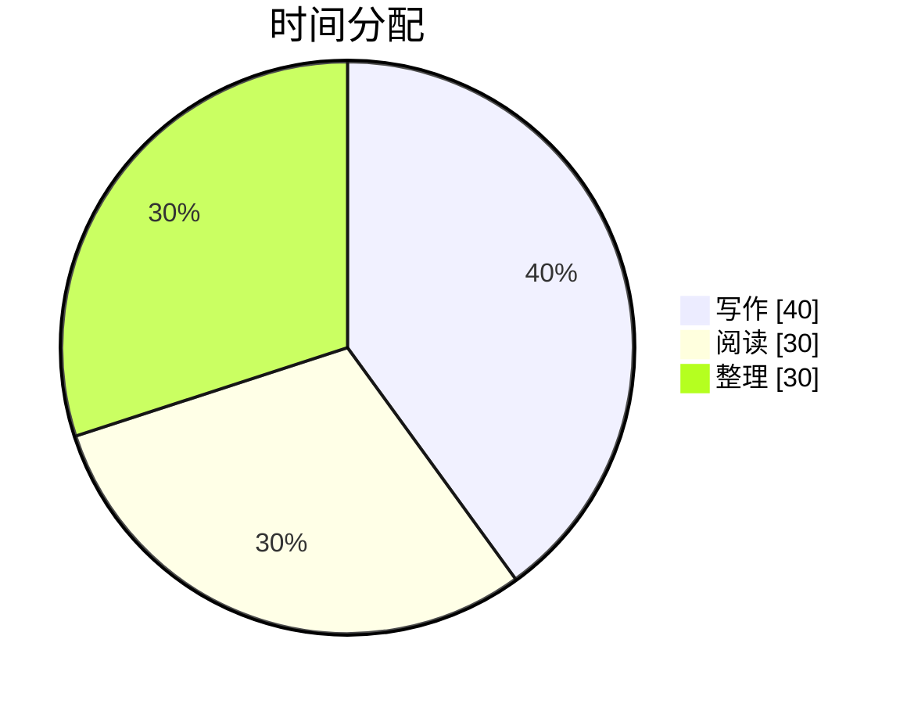
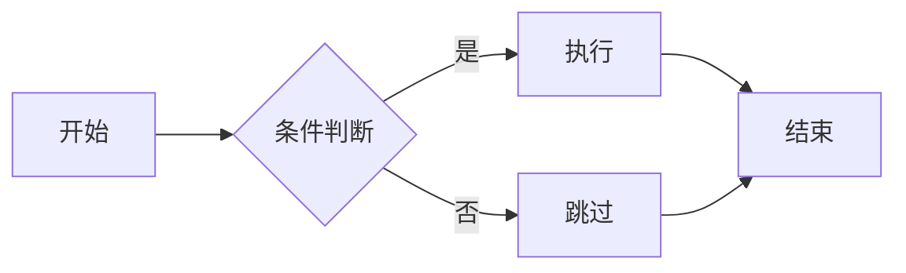
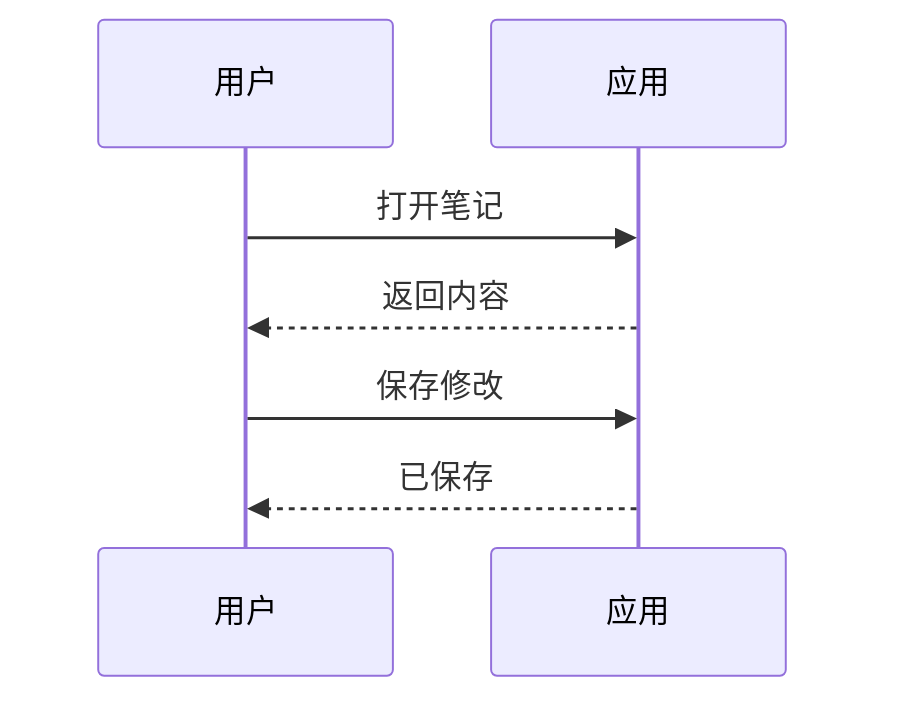
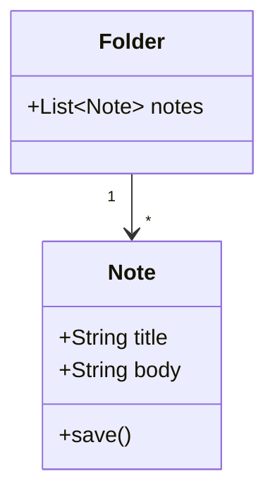
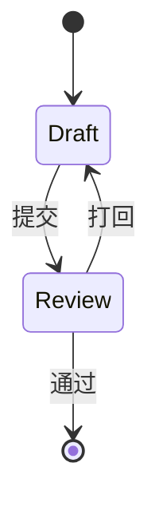
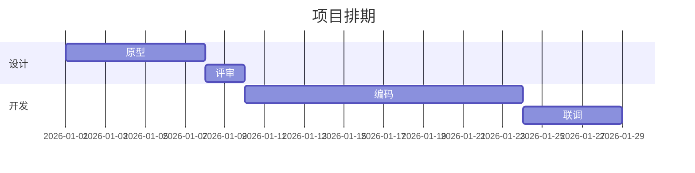
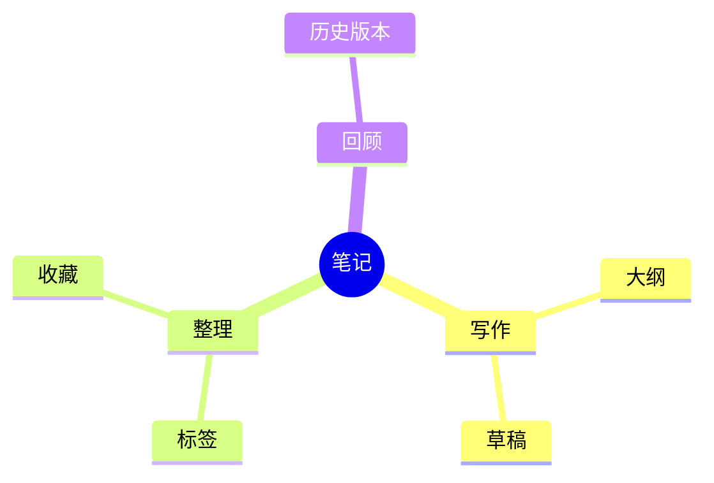
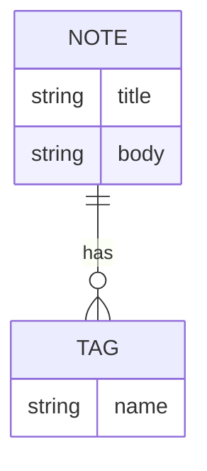
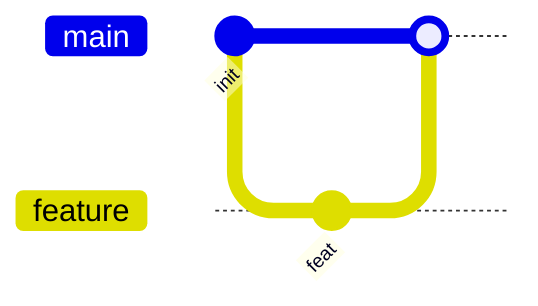

# 全功能测试

> 这一篇把 Markdown 全部语法和工具栏全部功能各留了一处示例。
> 建议配合「编辑区左半源码 / 右半预览」对照看：每节标题旁标注了对应工具栏入口。
> 本篇放在 demo 工作区时，双链 / 嵌入 / 图片引用都能解析；换到别的工作区这几处会显示为未找到，属于正常现象。

## 一、标题 H1–H6（工具栏：标题级别）

# 一级标题（H1）

## 二级标题（H2）

### 三级标题（H3）

#### 四级标题（H4）

##### 五级标题（H5）

###### 六级标题（H6）

左半源码里这六级都能看到井号；右侧大纲栏（中间列第二页签）应长出同样的标题树，点一下能跳转。

## 二、行内格式（工具栏：加粗 / 斜体 / 删除线 / 高亮 / 行内代码）

- **加粗**（Ctrl+B）
- *斜体*（Ctrl+I）
- ***粗斜体***
- ~~删除线~~（Ctrl+Shift+X）
- `行内代码`（Ctrl+E）
- 高亮五色（Ctrl+Shift+H 涂黄）：
  - ==黄色高亮==（默认）
  - =={green}绿色高亮==
  - =={blue}蓝色高亮==
  - =={rose}玫红高亮==
  - =={purple}紫色高亮==
- 转义字符：\*不是斜体\*、\`不是代码\`、\#不是标签
- 组合嵌套：**粗体里嵌 *斜体* 和 `代码`**

## 三、隐藏注释（工具栏：笔记工具 → 隐藏注释）

下面一行在源码里看得到，预览里应该完全消失：

%%这一整句是注释，预览里不该出现。如果预览里能看到我，说明注释渲染有 bug。%%

段落中间也能藏：这段话前面%%注释碎片%%正常接排，注释不换行。

## 四、链接与引用（工具栏：链接与引用菜单）

### 4.1 普通链接

- [Nota 官网兜底文案里的示例](https://example.com)
- 带标题的链接：[鼠标悬停看提示](https://example.com "这是 title 提示")
- 自动链接：<https://example.com>
- 相对路径笔记链接：[01 基础编辑与标题](入门/01%20基础编辑与标题.md)

### 4.2 双链（[[ ]]）

- 双链到入门篇：[[01 基础编辑与标题]]
- 双链带别名：[[02 行内格式|行内格式那篇（别名显示）]]
- 本篇内部标题锚点：[[#十、表格]]

### 4.3 笔记嵌入（![[ ]]）

![[03 列表与任务]]

上面应该把《03 列表与任务》整篇内容直接铺进来（预览态）。

### 4.4 块引用与块 ID（[[#^ ]] / ^）

下面这段话末尾挂了一个块 ID，右半预览里不显示它，源码里能看到：

这是一个被引用的目标段落，末尾跟着块 ID。 ^test-block-anchor

再引用它：

- 本篇内部块引用：[[#^test-block-anchor]]
- 跨笔记块引用（引用《05 代码块与表格》第一个标题块）：[[05 代码块与表格#]]

## 五、标签（工具栏：笔记工具 → 插入标签）

正文里直接打：#功能测试 #Nota应用 #标签_带下划线

侧栏「标签」区应该多出这三个；点其中一个筛选，再点一次取消（不出现叉号）。

## 六、列表（工具栏：无序 / 有序 / 任务列表）

### 6.1 无序列表（嵌套三层）

- 第一层
  - 第二层
    - 第三层
- 回到第一层
- 又一项

### 6.2 有序列表（嵌套）

1. 第一步
2. 第二步
   1. 子步骤 2.1
   2. 子步骤 2.2
3. 第三步

### 6.3 任务列表（可勾选）

- [ ] 未完成任务（点预览里的框应该能勾上）
- [x] 已完成任务
  - [ ] 子任务甲
  - [x] 子任务乙
- [ ] 最后一项

## 七、引用块（Ctrl+Shift+.）

> 一层引用，里面可以放 **加粗**、`代码` 和 [链接](https://example.com)。
>
> > 二层嵌套引用
> > > 三层嵌套引用

## 八、提示块 Callout（工具栏：内容块 → 提示）

> [!NOTE] 提示
> 这是唯一的提示块类型（NOTE）。标题、正文、**格式**、`代码` 都能放。

## 九、脚注（工具栏：链接与引用 → 脚注）

这是一句带脚注的话[^1]，同一脚注可以被引用第二次[^1]，还有第二个脚注[^长名字]。

[^1]: 第一个脚注的内容。点预览里的角标应能跳来跳去。
[^长名字]: 脚注名可以是长名字，也可以是数字。

## 十、表格（工具栏：表格，网格里拖选行列）

| 左对齐 | 居中对齐 | 右对齐 |
| :-- | :--: | --: |
| 单元格 | 单元格 | 单元格 |
| **粗体** | `代码` | [链接](https://example.com) |
| a | b | c |

表格内换行用 `<br>`：第一行<br>第二行

## 十一、代码块（工具栏：代码与图表 → 代码块；语言下拉；标行按钮）

普通无语言代码块：

```
纯文本代码块，没有语言标记。
```

带语言（右上角应有语言标签，可切换）：

```ts
interface Note {
  title: string;
  tags: string[];
}

// TypeScript 高亮：关键字、字符串、注释应各有其色
export function save(note: Note): boolean {
  if (!note.title) return false;
  return true;
}
```

```js
// JavaScript
const arr = [1, 2, 3].map((n) => n * 2);
console.log(`结果: ${arr.join(", ")}`);
```

```python
# Python
def fib(n):
    a, b = 0, 1
    while a < n:
        print(a, end=" ")
        a, b = b, a + b

fib(100)
```

```json
{ "name": "Nota", "version": "3.9.1", "features": ["双链", "导图", "AI"] }
```

```css
/* CSS */
.note-card { background: var(--n-code-surface); border-radius: 8px; }
```

```html
<!-- HTML -->
<div class="card"><p>你好，<strong>Nota</strong></p></div>
```

```bash
# Bash
npm run build && node scripts/release.mjs --patch
```

带标题 + 行号 + 标行（编辑器里把光标点进代码块任意行，工具栏「标行」按钮应亮）：

```js title="标行演示" line-numbers {2,4-5}
第一行（不该亮）
第二行（应亮）
第三行（不该亮）
第四行（应亮）
第五行（应亮）
第六行（不该亮）
```

## 十二、图表（工具栏：插入图表菜单，11 种模板全在这）

### 12.1 折线图

```mermaid
xychart-beta
  title "月度趋势"
  x-axis ["1月", "2月", "3月", "4月", "5月"]
  y-axis "数量" 0 --> 100
  line [28, 46, 39, 72, 88]
```

### 12.2 柱状图



### 12.3 饼图



### 12.4 流程图



### 12.5 时序图



### 12.6 类图



### 12.7 状态图



### 12.8 甘特图



### 12.9 思维导图



### 12.10 实体关系图



### 12.11 Git 提交图



## 十三、数学公式（工具栏：数学公式 → 行内 / 块级）

行内公式：质能方程 $E = mc^2$，以及 $\sum_{i=1}^{n} i = \frac{n(n+1)}{2}$。

块级公式（应独立成块居中渲染）：

$$
\int_{-\infty}^{\infty} e^{-x^2} \, dx = \sqrt{\pi}
$$

$$
f(x) = \begin{cases} x^2 & x \ge 0 \\ -x & x < 0 \end{cases}
$$

## 十四、图片与视频（工具栏：插入图片或视频菜单）

图片（demo 工作区的 attachments 里有这张）：


远程图片链接：


视频语法（本地视频用 `<video>` 标签，路径放 attachments/）：

```html
<video src="attachments/你的视频.mp4" controls></video>
```

## 十五、内容块（工具栏：内容块菜单）

### 15.1 折叠详情块

::: details 点我展开（折叠块示例）
这里是折叠起来的内容：**粗体**、列表、代码都能放。

- 折叠项一
- 折叠项二

```js
console.log("折叠块里也有代码");
```
:::

### 15.2 分栏标签

:::: tabs
::: tab-item 标签一
第一个标签页的内容。顶部应该出现「标签一 / 标签二 / 标签三」可点击切换。
:::
::: tab-item 标签二
第二个标签页的内容。
:::
::: tab-item 标签三
第三个标签页的内容。
:::
::::

### 15.3 分割线

上面这条水平线是三个减号画的（Ctrl+Shift+- 或菜单「分割线」）。

---

## 十六、混合压力测试（各种语法叠在一起）

> [!NOTE] 混合块
> 引用里放列表：
>
> - 列表项带 `代码`
> - 列表项带 **格式**
>
> 和公式：$a^2 + b^2 = c^2$

1. 有序列表里嵌表格：

   | 嵌套 | 表格 |
   | :-- | --: |
   | 左 | 右 |

2. 有序列表里嵌代码块：

   ```text
   列表缩进内的代码块
   ```

3. 任务列表里嵌引用：

   - [ ] 带引用的任务
     > 引用内容

段落里密集混排：**粗**、*斜*、~~删~~、=={green}亮==、`码`、[链](https://example.com)、$x_1$、#标签混排、#另一个标签、[[_05 代码块与表格]]——一行里全都有，两边预览都别崩。

## 十七、特殊内容

- Emoji：✅ ❌ 📝 🚀 🎉
- 中文标点：「引号」、（括号）、——破折号、……省略号
- 长英文换行：supercalifragilisticexpialidocious_supercalifragilisticexpialidocious
- 全角井号不当作标签：＃这不是标签
- 空行密集段落：

（上面是连续空行，下方一行接一行不空行）
第一行
第二行
第三行

---

## 附：工具栏功能对照表

| 工具栏入口 | 本篇对应章节 |
| :-- | :-- |
| 在本文中查找（Ctrl+F） | 任意章节，搜「测试」 |
| 标题级别 | 一 |
| 加粗 / 斜体 / 删除线 / 高亮 / 行内代码 | 二 |
| 标行（代码块选中行） | 十一（最后一段代码块） |
| 无序 / 有序 / 任务列表 / 引用块 | 六、七 |
| 链接与引用 → 链接 | 四.1 |
| 链接与引用 → 双链 / 嵌入 / 块引用 | 四.2 – 四.4 |
| 链接与引用 → 脚注 | 九 |
| 插入图片或视频 | 十四 |
| 笔记工具 → 标签 / 块 ID / Front Matter / 隐藏注释 | 五、四.4、文首、三 |
| 代码与图表 → 代码块 / 空白 Mermaid | 十一、十二 |
| 插入图表（11 种模板） | 十二（11 小节一一对应） |
| 表格 | 十 |
| 数学公式 → 行内 / 块级 | 十三 |
| 内容块 → 折叠详情块 / 分栏标签 / 分割线 / 提示 | 十五、八 |
