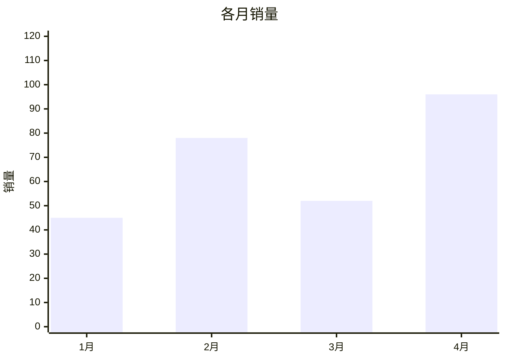
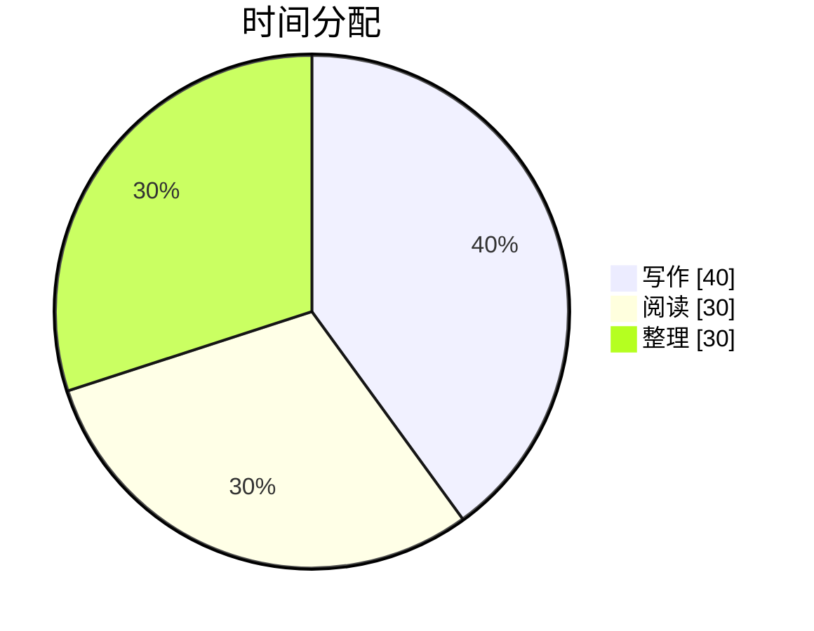
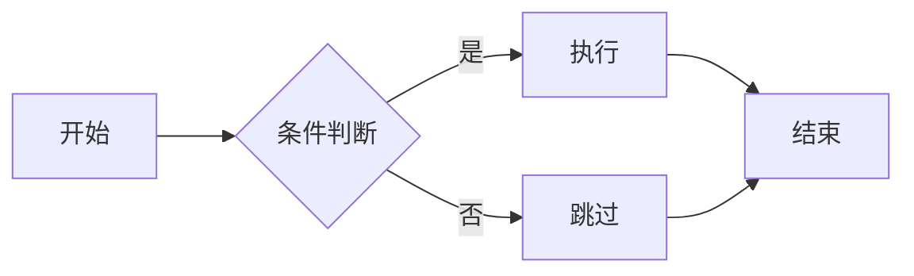
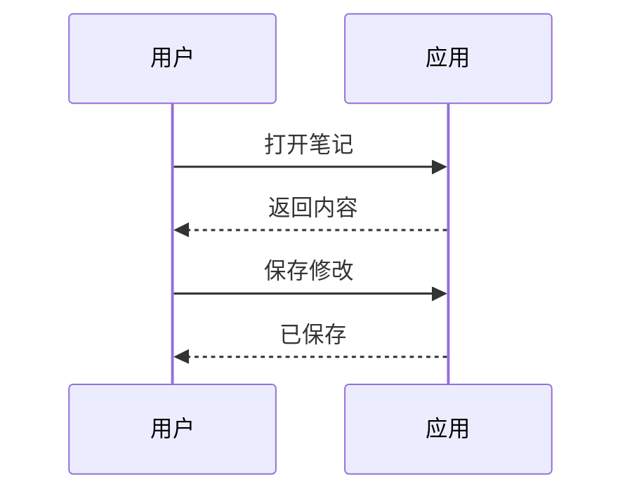
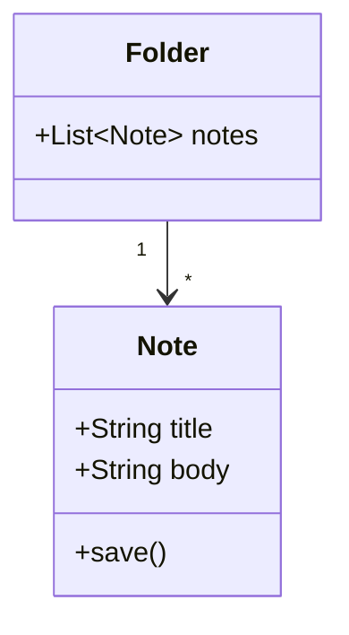
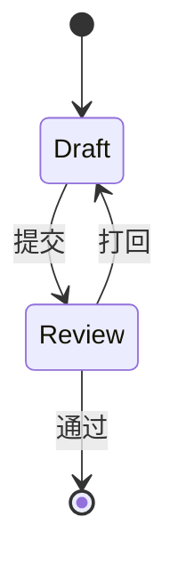
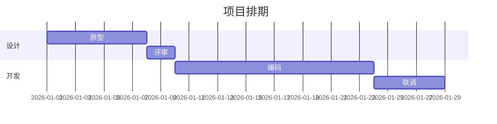
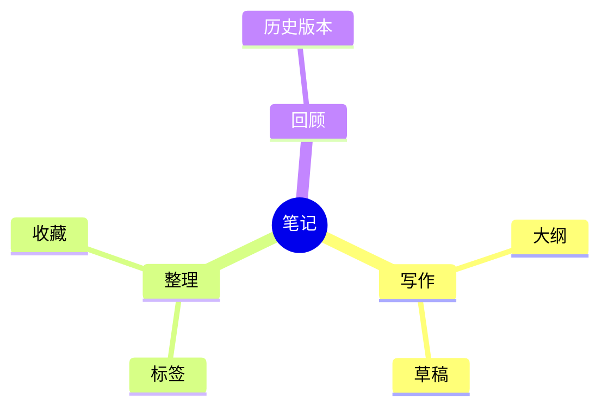
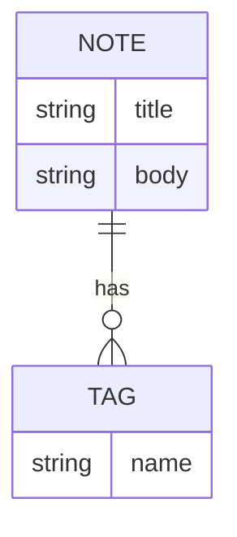
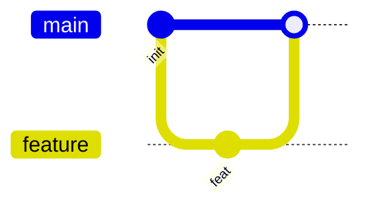

# 06 图表与流程图

工具栏那颗**折线图图标**里是十一种现成模板。点一个就插一段写好的 Mermaid 代码，
预览里会真的画出来（不是代码框）。

下面每一种都真的渲染了一遍 —— 任何一块显示成红色错误或者原始代码，就是它坏了。

## 折线图

```mermaid
xychart-beta
  title "月度趋势"
  x-axis ["1月", "2月", "3月", "4月", "5月"]
  y-axis "数量" 0 --> 100
  line [28, 46, 39, 72, 88]
```

## 柱状图



## 饼图



## 流程图



## 时序图



## 类图



## 状态图



## 甘特图



## 思维导图



## 实体关系图



## Git 提交图



## 写坏了会怎样

下面这个图是**故意写错的**（`flowchart` 后面跟了个不存在的方向）：

```mermaid
flowchart QQ
  A --> B
```

它不该让整篇预览白屏，只该在那一个块里变成红色的错误提示，别处照常。
