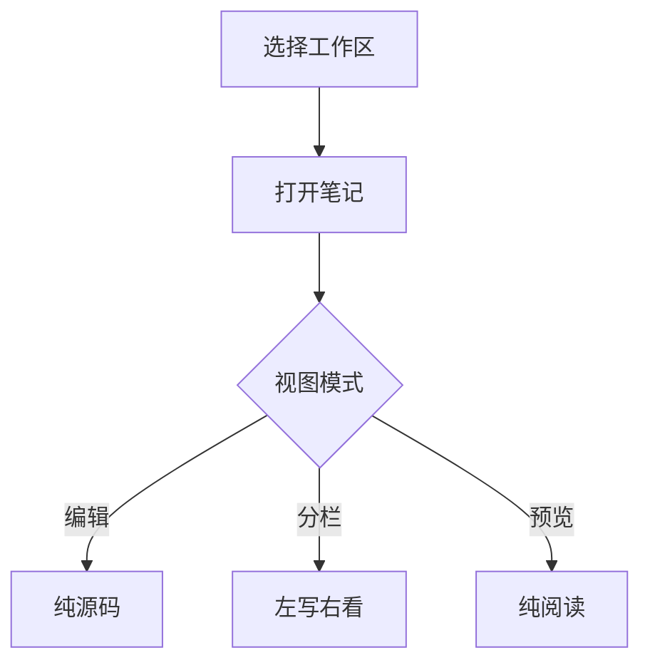
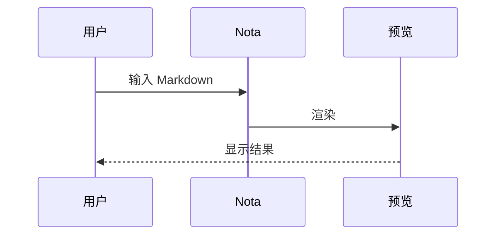

# 编辑器功能测试

这份笔记把 Nota 支持的语法**全过一遍**，用来逐项检查渲染是否正常。
**分栏模式**下左边源码、右边渲染结果；**编辑模式**只显示源码；**阅读模式**是纯预览。三种模式只影响显示，不影响内容。

> 用法：把这份文件放进你的工作区，打开它，从上往下看。**哪一段长得不对，就说明那一项有问题。**

## 标题层级

## 二级标题

### 三级标题

#### 四级标题

##### 五级标题

###### 六级标题

## 行内样式

**加粗**、*斜体*、~~删除线~~、==高亮==、`行内代码`，以及组合：***又粗又斜***。

普通链接 [Nota 项目](https://example.com)，行内公式 $E = mc^2$，以及脚注引用[^1]。

## 列表

- 无序项一
- 无序项二
  - 嵌套一层
- 无序项三

1. 有序项一
2. 有序项二
3. 有序项三

- [ ] 待办：还没做
- [x] 已完成：做完了

## 引用

> 普通的引用块，应当有一道竖线和浅底。

## 提示块（Callout）

> [!NOTE] 说明
> 这是在正文里插入的一段补充信息。

> [!TIP] 技巧
> 用 `Ctrl + \` 可以快速折叠侧边栏。

> [!WARNING] 注意
> 深色主题下预览的选中色会跟着换。

> [!DANGER] 危险
> 删除笔记会先进回收站。

> [!INFO] 信息
> 没写标题时，会用类型自己的默认名字。

> [!SUCCESS] 成功
> 保存成功时右上角会亮一下。

> [!IMPORTANT] 重要
> 这条用来强调。

> [!QUESTION] 疑问
> 这条用来提问。

> [!QUOTE] 引文
> 这条用来放别人的话。

## 折叠详情

::: details 点开看详情
这里是折叠起来的内容，展开后应当是一段正常排版的正文。

- 里面可以放列表
- 也可以放 `行内代码`
  :::

## 分栏标签

:::: tabs
::: tab-item 标签一

第一个标签页的内容。

:::
::: tab-item 标签二

第二个标签页的内容。

:::
::: tab-item 标签三

第三个标签页的内容。

:::
::::

## 表格

| 功能 | 状态 | 备注            |
| -- | -- | ------------- |
| 编辑 | 可用 | 纯 Markdown 源码 |
| 分栏 | 可用 | 左边写右边看        |
| 预览 | 可用 | 渲染后阅读         |
| 大纲 | 可用 | 中间栏页签         |

表格对齐：默认居中；作者自己标了就听作者的。

| 左对齐 |  居中 | 右对齐 |
| :-- | :-: | --: |
| 内容  |  内容 |  内容 |

## 代码

```ts
interface Note {
  id: string
  title: string
  tags: string[]
}

function greet(note: Note): string {
  return `正在编辑 ${note.title}`
}
```

```bash
npm run dev    # 开发
npm run pack   # 打包，自动滚版本并清掉旧包
```

## 代码块（高级：标题 + 行号 + 高亮行）

```python
第一行
第二行
第三行
第四行
```

上面这段应当有：**顶部一条标题栏「示例脚本」**、**左侧行号**、**第 2 行整行高亮**。

## 公式

行内公式 $\alpha + \beta = \gamma$ 嵌在句子里。

块级公式：

$$
\int_{0}^{\infty} e^{-x^2}\,dx = \frac{\sqrt{\pi}}{2}
$$

## 图表（Mermaid）





图表的颜色应当**跟着深浅主题走**：切到深色，图也跟着变，而不是一直一个色。

## 标签与块 ID

行内标签：#测试、#随手记

给这一段起个名字 ^kaishi

块 ID 应当渲染成一枚小徽标。上面那行末尾的 `^kaishi` 就是这段的名字，可以被别人引用。

## 指向另一篇的三种写法

> 下面三处的笔记名要**换成你工作区里真实存在的那篇**。名字对得上，链接就是实线可点；对不上会变成虚线并提示找不到。

双链（点一下跳过去）：[[另一篇笔记]]

嵌入（把那篇的内容拉到这里显示）：\![[另一篇笔记]]

块引用（精确指到那一篇的某一块）：[[另一篇笔记#^块ID]]

## 图片与视频


<video src="attachments/demo.mp4" controls></video>

工作区里没有这两个文件时会显示成破图，属正常 —— 这一项验的是**语法被识别**，不是文件存在。

## 隐藏注释

%%这句是隐藏注释，预览里不该出现%%

上面那句如果显示出来了，说明隐藏注释没生效。

---

分割线以上是正文。

[^1]: 这是脚注的正文，应当收在文末的「脚注」区，而不是停在这里。
