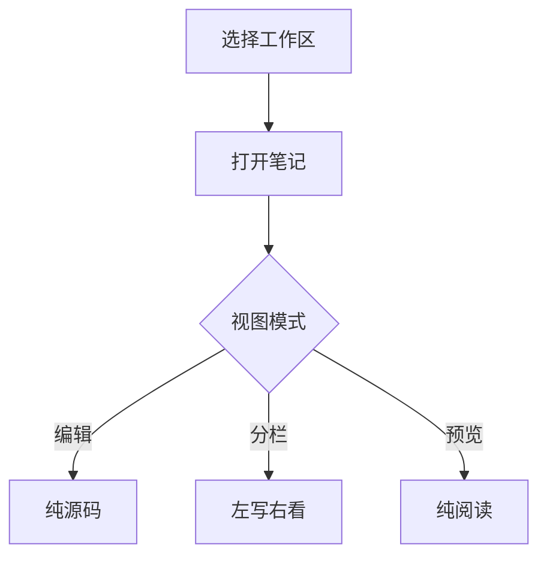

# 编辑器功能测试

这份笔记把编辑器支持的语法全过一遍。**分栏模式**下左边是纯编辑、右边是这份渲染结果；
**编辑模式**只显示源码；**阅读模式**是纯预览。三种模式应当只影响显示，不影响内容。

## 二级标题

### 三级标题

#### 四级标题

##### 五级标题

###### 六级标题

## 行内样式

**加粗**、*斜体*、~~删除线~~、==高亮==、`行内代码`，以及组合：***又粗又斜***。

普通链接 [Nota 项目](https://example.com)，行内公式 $E = mc^2$，以及脚注引用[^1]。

[^1]: 这是脚注的正文，应当收在文末。

## 列表

- 无序项一
- 无序项二
  - 嵌套一层
- 无序项三

1. 有序项一
2. 有序项二
3. 有序项三

- [ ] 待办：还没做
- [x] 已完成：做完了

## 引用

> 普通的引用块，应当有一道竖线和浅底。

## 提示块（Callout）

> [!NOTE] 说明
> 这是在正文里插入的一段补充信息。

> [!TIP] 技巧
> 用 `Ctrl + \` 可以快速折叠侧边栏。

> [!WARNING] 注意
> 深色主题下预览的选中色会跟着换，不要写死颜色。

> [!DANGER] 危险
> 删除笔记会进系统回收站。

## 折叠详情

::: details 点开看详情
这里是折叠起来的内容，展开后应当是一段正常排版的正文。

- 里面可以放列表
- 也可以放 `行内代码`
:::

## 分栏标签

:::: tabs
::: tab-item 标签一

第一个标签页的内容。

:::
::: tab-item 标签二

第二个标签页的内容。

:::
::::

## 表格

| 功能 | 状态 | 备注 |
| --- | --- | --- |
| 编辑 | 可用 | 纯 Markdown 源码 |
| 分栏 | 可用 | 左边写右边看 |
| 预览 | 可用 | 渲染后阅读 |
| 大纲 | 可用 | 右侧标题导航 |

## 代码

```ts
interface Note {
  id: string
  title: string
  tags: string[]
}

function greet(note: Note): string {
  return `正在编辑 ${note.title}`
}
```

```bash
npm run dev    # 开发
npm run pack   # 打包，自动滚版本并清掉旧包
```

## 图表



## 公式块

$$
\int_{0}^{\infty} e^{-x^2}\,dx = \frac{\sqrt{\pi}}{2}
$$

## 其它

行内公式 $\alpha + \beta = \gamma$ 嵌在句子里。

---

分割线以上是正文。下面是图片语法（工作区里没有该文件时会显示成破图，属正常）：


<!-- 这是 HTML 注释，预览里不该出现 -->
